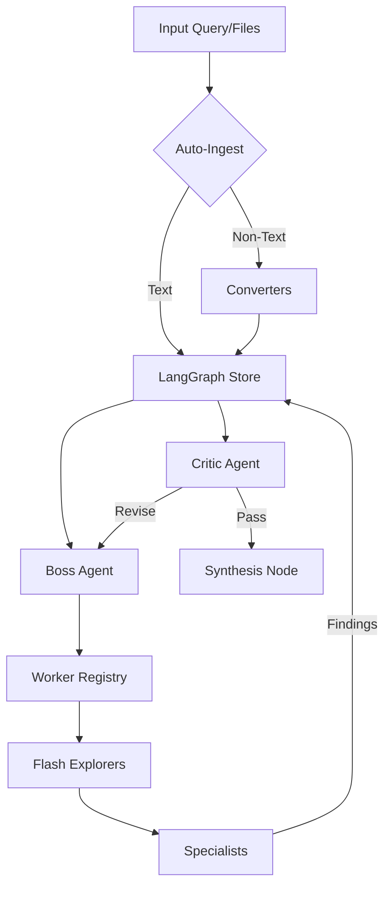

# System Architecture

The Deep Research Engine is built on a **recursive, multi-agent orchestration** pattern using LangGraph. It prioritizes state persistence, semantic memory, and high-fidelity critique loops.

## Overview



## Core Components

### 1. The Orchestration Layer (LangGraph)

Everything in the engine is a node in a state graph.

- **Checkpointer**: State persistence via PostgreSQL, allowing sessions to be paused and resumed
- **Store**: A unified, auto-vectorized memory system where every `write_file` operation is automatically embedded and indexed for semantic search

### 2. Deep Agent Hierarchy

We employ a tiered model approach to balance intelligence and cost:

- **Smart Tier (Claude 3.5 Sonnet)**: Used for the *Boss Agent* (planning) and *Critic Agent* (evaluation)
- **Fast Tier (Claude 3.5 Haiku)**: Used for *Flash Explorers* and specialized task runners

### 3. Integrated Storage Stack

The backend relies on a harmonized suite of databases:

- **Postgres + pgvector**: The primary brain for state and semantic memory
- **Neo4j**: Optional knowledge graph builder for extracting complex relationship entities
- **MinIO**: Object storage for large artifacts, reports, and raw media

---

## 5-Node Pipeline

The engine uses a simplified 5-node architecture:

```
┌─────────────┐     ┌─────────────┐     ┌─────────────┐     ┌─────────────┐     ┌─────────────┐
│  Ingestion  │ ──→ │   Drafter   │ ←─→ │   Critic    │ ──→ │    Neo4j    │ ──→ │  Synthesis  │
│    Node     │     │    Node     │     │    Node     │     │   Builder   │     │    Node     │
└─────────────┘     └─────────────┘     └─────────────┘     └─────────────┘     └─────────────┘
       ↓                   ↓                   ↓                   ↓                   ↓
  Extract text        Plan & execute      Quality gate      Build knowledge     Generate final
  from sources        research tasks      & revision        graph               report
```

### Ingestion Node

- Extracts text from various sources (PDFs, audio, video, web)
- Converts multimodal content to clean text
- Uses VibeVoice ASR for audio transcription with diarization
- Integrates with shared multimodal tools

### Drafter Node

- Main research logic
- Orchestrates Flash subagents for autonomous exploration
- Fans out to specialist workers for specific tasks
- Accumulates findings in state

### Critic Node

- Quality assurance gate
- Evaluates findings against criteria
- Routes back to Drafter for revision if needed
- Ensures completeness and accuracy

### Neo4j Builder Node

- Optional knowledge graph construction
- Extracts entities and relationships
- Builds semantic connections
- Enables graph-based queries

### Synthesis Node

- Generates final output
- Formats as research report, markdown, or JSON
- Adds citations and metadata
- Produces deliverable artifacts

---

## Specialized Workers

Workers are registered in a central registry and can be dynamically spawned by the Drafter.

| Worker | Capabilities |
| :--- | :--- |
| **Web Researcher** | Autonomous search, link crawling, and content extraction |
| **Document Processor** | Deep chunking and semantic analysis of long-form reports |
| **Multimodal Agent** | ASR (Whisper), VLM (Vision), and frame-by-frame video analysis |
| **Scraper** | Web scraping with robots.txt compliance |
| **Synthesis** | Report generation with citation formatting |

---

## Architectural Philosophy

> "Do not trust, verify."

The Critic Node is the gatekeeper. No research finding is accepted until it has been cross-referenced against the internal store and validated by a secondary high-intelligence model.

---

## Design Decisions

### Generic State Design

- **18 fields max** - Avoids the 50+ field bloat of previous implementations
- **Context dict** - Workflow-specific data stored in `context` field
- **Type safety** - TypedDict for IDE support and mypy validation

### Pluggable Storage

- **Optional backends** - Enable only what you need
- **Uniform interface** - All backends implement `StorageBackend` ABC
- **Registry pattern** - Easy to add new backends

### Worker ABC

- **Uniform contract** - All workers implement `execute(state, config) -> WorkerResult`
- **Built-in helpers** - Timing, error handling, retry logic
- **Registry pattern** - Dynamic worker discovery

### Config-Driven

- **New workflow = new YAML** - No code changes needed
- **Environment variables** - Secure configuration with `${VAR}` syntax
- **Validation** - Schema validation on load

---

## Reference

- **[Workflow Configs](../user-guide/workflows)** - Config reference
- **[Workers Guide](../user-guide/workers)** - Worker implementation
- **[Storage Backends](../user-guide/storage)** - Storage configuration
- **[Design Decisions](./design-decisions)** - Detailed design docs
